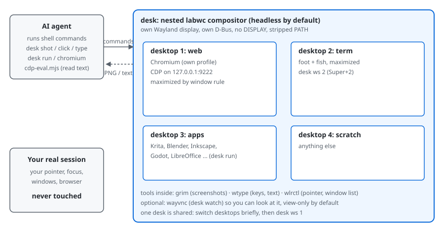

# claude-desk

A private nested desktop for AI agents. The agent gets its own labwc (Wayland) session where it can run GUI apps and a
browser, take screenshots, click and type, without touching your real screen: your pointer, focus and windows stay yours.

## Set it up with an agent (copy and paste)

> Install claude-desk from https://github.com/cosineFox/claude-desk: clone it, read its AGENTS.md, and follow it to install, verify and report. Put it wherever I keep my tools (ask me if you can't tell), and tell me once what system packages you need before installing them.

## Set it up yourself

    git clone https://github.com/cosineFox/claude-desk <wherever you keep tools>
    <that folder>/install.sh      # links ~/.local/bin/desk, runs `desk doctor`, prints the package command for your distro
    desk start && desk chromium https://example.com && desk shot

## How it works

1. `desk start` launches a second labwc compositor, headless, inside your session, with its own Wayland display and D-Bus. Nothing is shown on your screen.
2. The agent works through plain shell commands: `desk run <app>` starts a GUI app inside it, `desk shot` screenshots it (`grim`), `desk click X Y`, `desk type`, `desk key` act on it (`wlrctl`, `wtype`). Click coordinates are screenshot pixels.
3. `desk chromium <url>` starts a browser with its own profile and a debugging port, so the agent can read page text with `cdp-eval.mjs` instead of screenshotting.
4. There are four desktops (web, term, apps, scratch) in one shared desk. Switch with `desk ws N`, and go back to desktop 1 when done.
5. `desk watch` streams the desk over VNC if you want to look. `desk stop` ends the desk and the apps in it.

Typical loop for an agent: `desk start` → `desk chromium <url>` → `desk shot` and look → `desk click` / `desk type` → read text over CDP → `desk stop`.
Need a second, independent desk? Give it its own `DESK_STATE`, `DESK_PROFILE` and `DESK_CDP_PORT`.

## Desk manager (terminal app, like btop)
`desk manager` opens a full-screen terminal app: a list of every window in the desk (even on other desktops) with a live preview of the selected one. Keys: `j`/`k` or arrows to select, `1`-`4` switch desktop, `r` resize the desk, `s` save the window as a PNG, `q` quit.
Previews are sharp sixel images in terminals that support it (foot does) and colored half-blocks elsewhere (Alacritty, kitty, ...). Force one with `DESK_PREVIEW=sixel|blocks|none`.
Scriptable too: `desk manager list`, `desk manager shot <n|id> [file.png]`, `desk manager ws N`, `desk manager resize WxH`.
It's a ~0.65 MB Rust binary (wayland-client, png), no async runtime. Build it once with `cargo build --release` in `manager/`. Window capture uses `grim -T`, which needs a compositor with ext-foreign-toplevel (labwc 0.20 works; other versions untested).

## What you get
- Headless by default: no window, no host compositor needed (SSH and containers are untested; the headless backend may need a render node or `WLR_RENDERER=pixman`). `DESK_VISIBLE=1 desk start` shows it as a window in a Wayland host instead.
- Apps run with a clean environment: no `DISPLAY`, a stripped `PATH` for the compositor.
- 4 named desktops (web, term, apps, scratch). Chromium with CDP on 127.0.0.1:9222. Optional Playwright MCP (`desk mcp`).
- `desk watch` streams the desk over VNC so you can see (or, with `control`, drive) what the agent is doing.

## Commands
Run `desk` with no argument for the list. Main ones: `start [WxH]`, `stop`, `status`, `doctor`, `run <cmd>`, `chromium [url]`,
`shot [file]`, `click X Y`, `type <text>`, `key <key> [mods]`, `scroll`, `windows`, `ws N [move]`, `reload`, `watch`, `mcp`.

## macOS, Windows
No Wayland there, so use the Docker setup in [`docker/`](docker/README.md). It is untested; reports welcome.

## Requirements
Linux (macOS/Windows: see Docker above). Required: `labwc`, `wlr-randr`, `wtype`, `grim`, `wlrctl`, `dbus-run-session` + `dbus-daemon`, `curl`, `coreutils`, a Chromium-family browser.
Optional: `foot` (terminal), `wayvnc` + a VNC viewer (`desk watch`), `node`/`npx` (`desk mcp`), `flock`.
`desk doctor` checks all of this. The original script ran daily on Arch (labwc 0.20.2, Chromium 155, wlrctl 0.2.2). This packaged release has not had its first full test run yet, and other distros are untested. Needs bash 4.4+. On Ubuntu, `apt install chromium` is a snap that can't use a profile under `~/.local`; use Chrome/Chromium from another source (`DESK_CHROMIUM`). Needs labwc 0.7+ for the window rules (older versions are untested).

## Configuration (environment)
`DESK_STATE` (default `~/.local/state/claude-desk`), `DESK_PROFILE` (Chromium profile), `DESK_CDP_PORT` (9222),
`DESK_VNC_PORT` (5901), `DESK_CHROMIUM` (browser binary), `DESK_PLAYWRIGHT_MCP` (npm package), `DESK_VISIBLE=1`.
Edit `labwc-config/rc.xml` and run `desk reload` to change desktops, keybinds and window rules.

## Security: this is not a sandbox
The desk runs as your user. Apps inside it can reach your files, your network, and (by name) the host's runtime dir and session bus.
The CDP port (9222) and VNC port (5901) listen on 127.0.0.1 with no authentication, so any local process can control the browser or desk.
The desk's Chromium keeps its logins in its own profile (`--password-store=basic`, unencrypted). Don't log in to accounts you wouldn't hand to the agent.
What it does give you: the agent's input and windows are kept off your real session.

## Limits
- `desk stop` ends the compositor and the apps in it. Apps started with `desk run` get their own session, so a non-GUI command can outlive `stop`.
- `desk watch` assumes TigerVNC's `vncviewer` (`-ViewOnly`) and opens a viewer only when a host display exists.
- Only the nested desktop is controlled; driving the real desktop is deliberately not supported.
- With `DESK_VISIBLE=1`, `shot` fails after a 10 s timeout while the desk's window is on a hidden workspace of the host.
- `desk watch control` (clicking from the VNC viewer) is untested end to end.
- Reading page text is cheaper than screenshots: `node /path/to/claude-desk/cdp-eval.mjs <url-substring> "<js>"` evaluates JS in a Chromium tab over CDP.

## License
MIT
